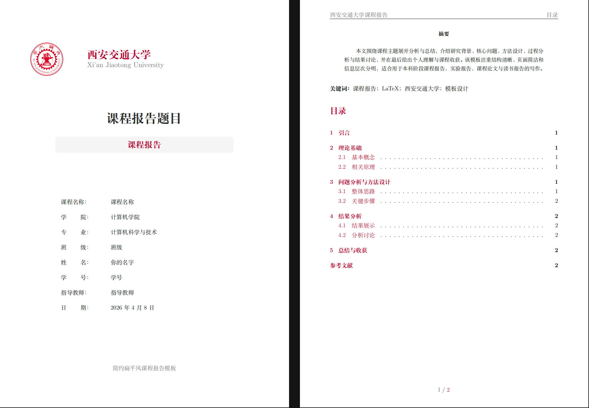
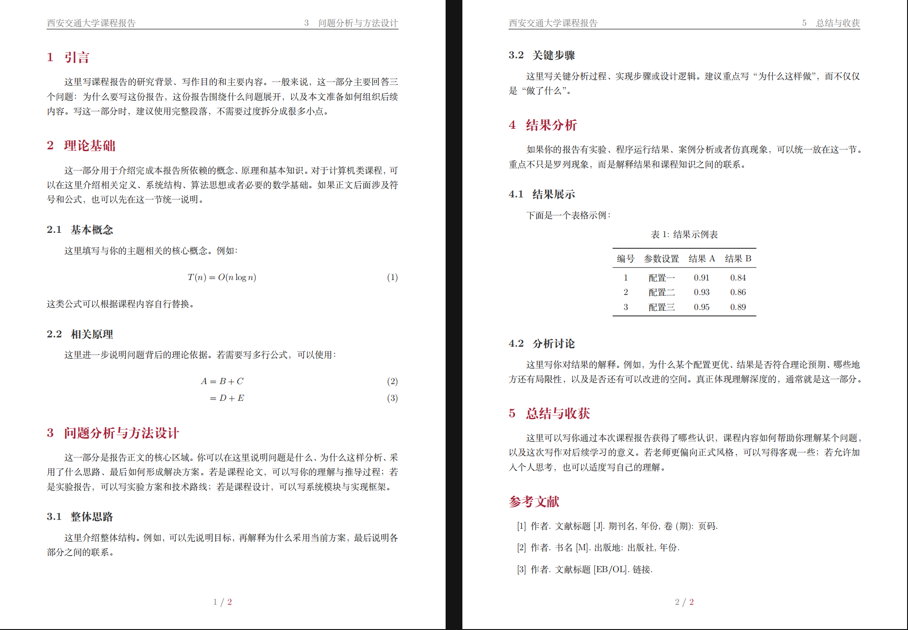

<div align="center">

# XJTU Course Report LaTeX Template

一份简洁、现代、西安交通大学视觉风格的课程报告 LaTeX 模板。


</div>

## 项目简介

这是一个面向西安交通大学课程报告、实验报告、课程论文与读书报告的 LaTeX 模板。模板基于 `ctexart`，默认支持中文排版，并提供了完整的封面、摘要、目录、页眉页脚、章节样式、表格、公式与参考文献示例。

如果你希望快速写出一份结构清楚、版面干净、风格统一的课程报告，可以直接从 `main.tex` 开始修改。

## 效果预览





## 特色

- `XJTU` 风格封面：包含校名、校徽区域、课程信息表与报告标题。
- 中文友好：基于 `ctexart`，适合中文课程报告写作。
- 结构完整：内置摘要、关键词、目录、正文、结果分析、总结与参考文献。
- 版式清爽：统一配色、页眉页脚、章节标题与行距设置。
- 常用元素齐全：提供数学公式、对齐公式、三线表与参考文献条目示例。
- 可继续扩展：已引入 `tcolorbox`、`booktabs`、`longtable`、`svg` 等常用宏包。

## 快速开始

1. 克隆或下载本仓库。
2. 打开 `main.tex`。
3. 修改报告基本信息：

```tex
\newcommand{\ReportTitle}{课程报告题目}
\newcommand{\CourseName}{课程名称}
\newcommand{\StudentName}{你的名字}
\newcommand{\StudentID}{你的学号}
\newcommand{\School}{你的学院}
\newcommand{\Major}{你的专业}
\newcommand{\ClassName}{你的班级}
\newcommand{\Instructor}{你的指导教师}
\newcommand{\DateInfo}{\today}
```

4. 将正文示例替换为自己的内容。
5. 使用 XeLaTeX 编译。

```bash
xelatex main.tex
xelatex main.tex
```

如果你安装了 `latexmk`，也可以使用：

```bash
latexmk -xelatex main.tex
```

## 推荐环境

- TeX Live、MacTeX 或 MiKTeX
- XeLaTeX
- Inkscape，可选，仅当你需要插入或转换 SVG 图片时使用

模板使用了 `ctexart`，因此建议优先使用 XeLaTeX 编译，不建议直接使用 pdfLaTeX。

## 目录结构

当前项目结构非常轻量：

```text
.
├── LICENSE
├── README.md
├── .gitignore
├── main.tex
├── asserts/
│   ├── 1.png
│   └── 2.png
└── figs/
    ├── a4-2xhred.png
    └── logo.png
```

其中：

- `main.tex` 是模板主文件。
- `figs/a4-2xhred.png` 是封面使用的横版校标，包含校徽及中英文校名。
- `figs/logo.png` 是保留的独立校徽图片资源。
- `figs/` 建议继续用于存放报告中的图片素材。
- `asserts/` 用于存放 README 中展示模板效果的预览图片。

## 注意事项

当前 `main.tex` 中封面图片路径写为：

```tex
\includegraphics[width=0.60\textwidth]{figs/a4-2xhred.png}
```

因此请确保校标图片位于 `figs/a4-2xhred.png`。如果编译时提示找不到图片，可以检查文件名大小写、图片格式以及相对路径是否一致。

如果你需要插入 SVG 图片，请确保本机已安装 Inkscape，并且命令行中可以访问 `inkscape`。


## License

本项目的图片资源来源于西安交通大学官方资源，仓库作者无意侵犯任何著作权利，如有疑问，请随时联系我。

本项目基于 [MIT License](LICENSE) 开源，允许自由使用、修改与分发。使用时请保留原许可证声明。
